# Format: CARDBOARD 2.0 — the MAIN format (any niche)

Paper-craft dioramas filmed like a tabletop movie: photoreal cardboard sets lit per scene, jointed cut-out puppets
with measured eyes on 12 fps steps, the maker's own hand stepping into frame, and motion graphics made of PAPER
(flip counters, stamps, sticky notes, string charts, index cards). One shared library, one kit, any story: history,
finance, science, animals, crime, horror, kids.

| What | Where |
|---|---|
| **Reference film — copy it** | THE COBRA EFFECT · slug `cobra-cardboard` · component `CobraCardboard` · 71.9 s. Code `src/episodes/cobra-cardboard/`, story files `episodes/cobra-cardboard/` (brief, shots, script, cast, sfx, music, art catalog) |
| Shared library | `public/_lib/cardboard/` — 764 assets, 36 MB (WebP + contact sheets), typed manifest |
| Kit | `src/kit/cardboard/` — every file documented at its top |
| Lab (every component on one timeline) | composition `CardboardLab` (`src/episodes/cardboard-lab/`, ≈ 110 s): cast, outfits, hats, eye styles, expressions, mouths, poses, the 10 vibes, 6 sets, maker's-hand poses, paper MG, transitions, side view, dark vibes |
| Art briefs (the spec for new pieces) | `art/briefs/_common.md` + examples `07-cobra.md` (a film's own pieces), `_hires.md`, `_side.md` |

> [!IMPORTANT] Only this format uses generated images — and only through Codex
> Craft assets come from a **Codex bb thread with its `imagegen` skill**. You never call an image API yourself; you
> brief, review, key, measure and animate. Everything generic already exists in the library: commission ONLY what is
> unique to your story (its creature, a period costume, a landmark skyline).

---

## 1 · Content rules (owner — read first, apply to every line)

1. **ENGAGING and SHORT.** 55–75 s; aim for **≤ 72 s** (≈ 150–180 words at 2.7–2.9 words/s). Never boring, never long.
2. **VERY easy English — a 3rd grader understands every sentence.** Short sentences, one idea per line, everyday
   words. Read each line aloud: if a child would ask "what does that mean?", rewrite it.
3. **Very FEW numbers and names.** One or two places at most, no dates unless the date IS the point, numbers only
   where a counter can show them. No jargon unless you explain it in kid words in the same line
   ("That's the cobra effect: when a reward makes the problem worse.").
4. **Fun, clear, surprising beats beat completeness.** It doesn't have to be deep. Cut every fact that doesn't make a
   beat; three surprising turns are better than ten correct details.
5. **Hook in 2 s.** A paradox, a claim or a question in the first line, and **frame 0 already shows it** (the cobra
   film opens on a dead snake and a coin being paid for it).
6. **True.** Every claim checked, sources in `brief.md`. Anecdotes are labelled on screen ("so the story goes…"
   sticky note); documented history gets a stamp ("TRUE STORY"). Never present a legend as fact.
7. **End on a CTA question about THEIR life** that people want to answer ("What's the cobra effect at your school or
   job? Comment below!").
8. **No series bar, no show name, no "PART" labels.** Not in the picture, not in the script.

<details>
<summary>Worked example — the cobra script (15 lines, 161 words, 71.9 s) and why each line works</summary>

| id | line | why |
|---|---|---|
| hook | They paid people to kill snakes... and got more snakes. | the paradox in 2 s; frame 0 = dead snake + coin |
| india | In old India, so the story goes, there were too many cobras. | one place, honesty label as a visual (sticky) |
| offer | So the rulers said: bring us a dead cobra, and we'll pay you! | the rule as a poster: [dead cobra] = [coin] |
| worked | It worked! Dead snakes poured in. | a short win before the turn |
| pile | But the pile kept growing. And growing. | the turn, said twice, shown as a pile |
| why | People were raising cobras at home, to kill for cash! | the surprise, in kid words |
| found | The rulers found out, and stopped paying. | a stamp: CANCELLED |
| letgo | What do you do with a yard full of snakes? Let them go! | question → punchline |
| more | Now there were more cobras than ever. | a string chart going the wrong way |
| name | That's the cobra effect: when a reward makes the problem worse. | the name + a kid definition, nothing more |
| rats | This one really happened: in Vietnam, they paid for rat tails. | the TRUE version, stamped |
| tails | So people cut off the tails, and let the rats go. To make more rats! | the same pattern, funnier |
| bank | Today, a bank rewarded workers for new accounts. So some made fake ones! | today, no brand name |
| rule | The lesson: reward a number, and people chase the number. Not the thing you wanted. | the takeaway, 3 short clauses |
| cta | What's the cobra effect at your school or job? Comment below! | a question about THEIR life |

Rejected first: a remake of the old explainer (Delhi 1890s place card, "economists call it…", 9,082 rat tails) —
accurate but dense, too many names and numbers.
</details>

---

## 2 · The look

- **Sets** are photoreal cardboard/paper dioramas from the library (rooms, offices, streets, alleys, forest, desert,
  village, old city, road, the maker's table), assembled in code on 2.5D planes with parallax and depth of field.
- **Puppets**: jointed paper-and-felt figures with brass brads (12 people + a zombie, front and profile), heads with
  NO painted eyes: eyes, brows and mouths are drawn in code on measured anchors (paper eyes with paper-lid blinks,
  googly, bead, dot, glow, dead "X"). They move on **12 fps steps** like real stop-motion.
- **Light** = a *vibe* per scene (warm bulb, noir lamp, cold night, horror flicker…): a key-light pool, cast shadows
  screen-aligned to the light, rim, bloom, gobo, practicals, dust, grain, flicker. Characters get their own subject
  light so they always read, even in dark vibes.
- **The maker's hand** (photoreal, charcoal knit sleeve) places, presses, pinches, swipes and gives the thumbs-up.
- **Motion graphics are paper objects in the world**: tape labels, sticky notes, stamps, index cards written on the
  words, flip counters with printed numerals, string charts, paper arrows. Never flat vector UI.
- **Captions**: Inter 800, 60 px, centred at y 1430, keywords coloured (gold = the subject, red = the problem),
  hidden on the CTA card.

## 3 · Pipeline at a glance

```mermaid
flowchart LR
  A[brief.md<br/>3 premises · facts] --> B[script.tsv ≤ 72 s<br/>cast.json Fish]
  B --> C[voice.py → stt_check]
  C --> D[shots.md<br/>beats on words]
  D --> E[library first<br/>commission only unique art]
  E --> F[beats.ts · Shots*.tsx]
  F --> G[stills rounds<br/>checklist §9]
  G --> H[sfx · music · sound.ts<br/>mix → stt_check]
  H --> I[slice → master<br/>through the queue]
  I --> J[frame QA · qa.py<br/>deliver · clean · commit]
```



---

## 4 · The shared library (`public/_lib/cardboard/`)

**Look before you use.** Open the contact sheets `public/_lib/cardboard/_sheets/<group>.jpg` with Read — every
anchor is drawn (red = eyes, orange = mouth, cyan = joints, magenta = other anchors, yellow = cut-through holes).
`README.md` in the same folder is the full catalog.

| Group | Ids | Contents |
|---|---|---|
| **Cast** (12 + zombie) | `cast/<who>/…` | walt (old man, moustache) · maya · leo · ravi (beard) · priya · mei · jun · rosa (old woman) · sam · nora (red hair) · kai (boy) · lily (girl) · zombie. Heads `head_ref head_f head_34 head_s` (measured `eyes[]`, `mouth`, `skin`); hi-res front body `torso upper_arm forearm leg_l leg_r legs_sit` + hands `hand_open point fist hold thumb wave`; the first low-res set in `lo/` |
| **Side view** (profile, walk/run) | `cast/<who>/side/*` | kai leo maya mei nora ravi sam walt + zombie: `head_ref torso thigh shin upper_arm forearm` + hands — knees and elbows bend |
| **Outfits** | `outfits/<name>/…` | detective (+ fedora) · police (+ cap) · suit · labcoat — any adult wears them with their own head and hands |
| **Accessories** | `acc/hats/*` `acc/face/*` | 16 hats (pith turban conical kepi tophat crown sunhat beanie police fedora cap hardhat chef grad cowboy tricorn) · glasses round/square/sun/half, monocle, eyepatch, bowtie, necktie, scarf, moustache |
| **Maker's hand** | `hand/<pose>` | from the top: point pinch press palm_up grab flick_ready flick_done · from the right: thumbs_up marker card push |
| **Materials · skies · ground** | `materials/*` `skies/*` `sets/ground/*` | kraft corrugated black_card felt newsprint cork cutting_mat wood paper_white · day dusk night storm · dirt cobbles sand asphalt lawn meadow, tufts, bushes |
| **Set kits** | `sets/<kit>/*` | room · office · street (facades with cut-through windows) · alley · forest · desert · village · oldcity · road · table (the maker's workbench, scissors, tape…) |
| **Prop packs** | `props/<pack>/*` | money · crime · horror · science · board · general · vehicles (with spinning wheels) |

```text
public/_lib/cardboard/
├── manifest.json          ← typed in src/kit/cardboard/library.ts (LIB)
├── README.md              ← the full catalog + how to extend
├── _sheets/<group>.jpg    ← contact sheets with anchors (LOOK at these)
├── cast/<who>/{head_*,torso,…,hand_*, lo/*, side/*}.webp
├── outfits/ acc/ hand/ materials/ skies/ sets/ props/
public/<slug>/lib/         ← a film's OWN pieces (+ its own manifest.json, _sheets/)
```

**Reusable vs per-episode.** A piece belongs in the library when a SECOND story would plausibly use it (people in
everyday clothes, generic outfits, hats, generic sets and props by niche). A film keeps its own creature, a period
costume only it needs, a real landmark skyline, story props (snake-charmer baskets, rat cages) in `public/<slug>/lib/`.

### Using it in code

```tsx
// lib.ts — the film's own pieces
import { makeLib, type Manifest } from "../../kit/cardboard";
import film from "../../../public/<slug>/lib/manifest.json";
export const FILM = makeLib(film as unknown as Manifest);

// in a shot

<Piece id="sets/office/desk" x={-60} y={1290} w={900} anchor="base" lift={14} />                // library piece
<Piece asset={FILM.get("basket/medium")} lib={FILM} x={-290} y={880} w={340} anchor="base" />     // film piece
<Puppet who="walt" outfit="colonial" lib={FILM} hat="outfit/colonial/hat_pith" x={-250} y={1110} h={860} … />
```
`LIB.get(id)` · `LIB.has(id)` · `LIB.find({ tag, vibe })` · `LIB.cast` (per person: scales, skin, side parts) ·
`CAST_IDS` · `OUTFITS`. Anchors are fractions of each image, so they survive any scale.

### Extending it (new art) — the only place you generate images

1. **Check the library first** (contact sheets). Commission only what is missing and unique.
2. **Brief** — copy `art/briefs/07-cobra.md` (a film's own pieces) and keep its first line: *"follow
   art/briefs/_common.md"*. The spec there is non-negotiable: photo of REAL paper craft; flat **#00FF00** background
   (**#FF00FF** for green subjects, no green/pink on the objects); neutral soft front light; ≥ 60 px margins and
   ≥ 80 px gaps; same scale per sheet; **no text anywhere**; heads WITHOUT eyes/brows/mouth but with **blue (#0000FF)
   dot stickers** where each eye goes and a small one at the mouth centre; brass brads at the joints; the BODY sheet
   (13 pieces) and HEADS sheet (front · ¾ · profile) layouts. For any period outfit brief **all** parts including
   `legs_sit` (a missing part means that character can never sit).
3. **Spawn** one Codex thread per batch, absolute output paths under `art/_raw/<batch>/`:
   `bb thread spawn --project proj_kax9max22t --parent-self --provider codex --title "Art · <slug> · <batch>" --prompt-file art/briefs/<nn>-<slug>.md --json`
   (it runs in the background; do other work, it reports back).
4. **Catalog** the sheets in `episodes/<slug>/art_catalog.py` (copy the cobra one: `src`, `layout: "items"`, `prefix`,
   `kind` = creature / facade / …, `names` in reading order, `eyes` count per piece, `view`). Name the pieces from the
   numbered index image: `.venv/bin/python scripts/cardboard_lib.py index art/_raw/<batch>/<sheet>.png` → `out/lib-index/`.
5. **Build**: `.venv/bin/python scripts/cardboard_lib.py build --film <slug>` — keys, slices, measures every anchor
   (blue dots → eye/mouth ellipses, brads/geometry → joints, soles, bases, fingertips), paints the dots out, bleeds
   the colour into transparent pixels, writes WebP + `public/<slug>/lib/manifest.json`.
6. **Look**: `.venv/bin/python scripts/cardboard_lib.py sheets --film <slug>` → `public/<slug>/lib/_sheets/*.jpg`.
   Every crosshair must sit on the right spot (eyes on the eyes!). Fix a bad anchor with `OVERRIDES` in the catalog
   or ask the Codex thread to redo that sheet. A reusable piece goes into `scripts/cardboard_catalog.py` instead
   (shared library) — then `cardboard_lib.py build --only <sheet>` and `sheets`.

---

## 5 · The kit (`src/kit/cardboard/`)

| File | Use |
|---|---|
| `stage.tsx` | `CardStage({vibe, cam, cast, children})` — `children` = the set, `cast` = puppets/props lit with the subject light. `Plane({z})` depth planes (parallax + DOF). `Piece` places any asset by anchor (`x y w/h/s anchor at rot flip lift boil tint children under`). `camKeys(t, [[t, x, y, zoom, rot?, focus?], …], ease)`, `camY(worldY, screenY, zoom)`. `Backdrop` `Surface` `FloorShadow` `Motes` `Grain` |
| `vibes.ts` | `VIBES.*` (10 lighting presets) and `NICHE_VIBE` (§6) |
| `sets.tsx` | assemblies: `Room({wall, floor, windows, door, back})` · `Street` · `Table({top, back, y0})` · `Outdoors({sky, ground, y0, far, mid})` · `Floor` · `WindowView` · `LitHoles` (glowing cut-through windows) |
| `puppet.tsx` | `Puppet` (front) and `PuppetSide` (profile, knees/elbows, `cycle(WALK|RUN, ts)` 4-drawing cycles, `STAND_SIDE` `SIT_SIDE`). Poses: `idle(ts)` `point(sh, el)` `wave(ts)` `shrug` `armsUp` `handsUp` `think()` `thumbsUp()` `hold(side, sh, el)` + `holdR/holdL` props (WORLD px) + `upright()`; `sit: true` |
| `face.tsx` | `Face`/`Eyes`/`Mouth`: eye styles `paper googly bead dot glow dead`, `EXPR` (neutral happy laugh surprised shocked angry sad worried sly sleepy scared determined greedy), `talkMouth`, `blinkAt`; puppets take `face={{ eyes, expr, look: [x, y] }}` |
| `hand.tsx` | `MakerHand({pose, tip, t0, t1, w, hold, holdUnder, press, rot})` — slides in along its own arm, holds, leaves; `tip` lands exactly on a world point |
| `mg.tsx` | paper motion graphics: `FlipCounter` `BigNumber` `Stamp` `Sticky` `TapeLabel` `TapeStrip` `IndexCard({lines, lineT})` `StringChart` `BarChart` `RouteMap` `Timeline` `Callout` `LowerThird` `PaperArrow` `Scribble` `Typewriter` `PaperCard` `PaperBacking`; fonts `CB.*` |
| `transitions.tsx` | `Shots({list: [{a, b, el, in}]})` — `in`: `cut` `slide` `push` `flip` `hand` `dip`; switches on the output frame |
| `library.ts` | `LIB`, `makeLib`, types |

Mount `<CardDefs />` once at the film root (paper filters). Register the film with `python3 scripts/gen_root.py`.

## 6 · Vibes per niche

| Niche | Vibe | Notes |
|---|---|---|
| explainer, animals, the maker's table | `warmBulb` | the house look: one warm practical bulb |
| kids, sunny outdoor | `brightDay` | high key, soft shadows |
| history, "long ago", dusk | `goldenDusk` | low warm sun, long shadows |
| archive, old photos | `sepiaArchive` | desaturated, paper-toned |
| true crime, detectives | `noirLamp` | desk lamp + blinds gobo |
| mystery, night | `coldNight` | blue moonlight (add a warm practical: an oil lamp, a window) |
| horror, zombies | `horrorFlicker` | flicker + red practical |
| finance, money | `financeSpot` | a spotlight on the subject |
| science, labs, modern offices | `labCool` | clean cool white |
| disaster, weather | `storm` | dark, flashes (`CardStage flashes`) |

Mix vibes by scene, not by film: the cobra film uses warm bulb (table, office), golden dusk (Delhi, letting go), cold
night + oil lamp (the snake farm), bright day (Hanoi), lab cool (the bank). Add a practical for motivation:
`{ ...VIBES.coldNight, practicals: [{ x: 0.12, y: 0.4, r: 0.55, color: "255,180,90", o: 0.55, flicker: "candle" }] }`.

## 7 · The hybrid motion-graphics grammar

**Three clocks.** Puppets and creatures move on **12 fps steps** (`const ts = useStepT()`): poses, walk cycles,
slithers, blinks. The **camera, light, dust, the maker's hand and the paper MG move continuously** (`useT()`).
Anything **discrete** — digits, captions, shot switches, and EVERY switch in a shot (a pose swap, a face change, a prop
appearing or dropping: `tq >= B.paid ? … : …`) — uses `useTq()` (snapped to the output frame) so the motion-blur master
never shows two states at once (a switch on `useT()` leaves one frame with a translucent echo of the old state).

**One device per beat** — the MG says the idea of the line, in paper:

| The line says… | Device | Cobra example |
|---|---|---|
| a number grows / races | `FlipCounter` (printed numerals; fast counting shows plain digits) | COBRAS, DEAD COBRAS, NEW ACCOUNTS |
| a rule / a deal | a paper poster or `IndexCard` | REWARD: [dead cobra] = [coin] |
| a verdict / a twist | `Stamp` (slams, red ink) | CANCELLED · FAKE · TRUE STORY |
| honesty / an aside | `Sticky` note | "so the story goes…" |
| a definition / the lesson | `IndexCard` whose lines write on the words (`lineT`) | THE COBRA EFFECT: when a reward makes the problem worse |
| a trend | `StringChart` (red string between pins) + `PaperArrow` | before → reward → after (way up) |
| a comparison / a route / a sequence | `BarChart` / `RouteMap` / `Timeline` | — |
| a sound or an action word | `TapeLabel` (pops, then goes) | "snip!" |
| a symbol to chase | `BigNumber` on a string, dangled by the maker's hand | "#1" |

**The maker's hand is the narrator's hand.** It sets the coin down (hook), presses the definition card, swipes the
scene away into a board, dangles the "#1", and gives the thumbs-up on the CTA. One entrance every ~10–15 s at most;
it never covers a face or an eye; it always comes from its own side (top poses from the top, `thumbs_up marker card
push` from the right).

**Transitions** (`Shots`): `slide` to a new place · `push` back to a place we know · `hand` (the palm swipes the card)
into a board/MG · `flip` (a page turns) into "this really happened" · `cut` within a scene or to a close-up ·
`dip` for a time jump. Give every transition a papery sound (§ Sound).

**Every shot moves**: a `camKeys` push/pull/track between its first and last frame, a live element (a cobra swaying,
dust, flicker), ≤ 6 s per shot, one idea per shot.

---

## 8 · Building an episode, step by step (any model can follow this)

```bash
WT=$(~/Developer/story-studio/scripts/new-worktree.sh <name>) && cd "$WT" && df -h ~    # ≥ 30 GB free
mkdir -p episodes/<slug> src/episodes/<slug>
```

1. **Brief** `episodes/<slug>/brief.md` (copy the cobra one): premise in one sentence · 3 premises considered and
   why the pick wins · facts table (claim → documented / anecdote → source) · look (sets, vibes per scene) · length.
2. **Script** `episodes/<slug>/script.tsv` (`id⇥N⇥[tag] line⇥`), applying §1 line by line; ≈ 150–180 words.
   `cast.json`: the Fish narrator (voice.md):
   `{"N": {"provider": "fish", "model": "drama-3-preview", "voice": "8d21b053e2804e2a890e1cf62f267b6f", "name": "Verity (Fish)", "temperature": 0.7, "top_p": 0.7}}` — never "adam adam" (owner: bad and too common); see voice.md for the approved Fish voices
3. **Voice** `.venv/bin/python scripts/voice.py <slug>` → `.venv/bin/python scripts/stt_check.py <slug>` (≥ 0.97).
   Check the length (`lines.json` last `end` + 1.4 s ≤ 72 s) and pace (2.7–3.0 w/s). Too long → cut words, not speed.
4. **Shot list** `episodes/<slug>/shots.md`: one row per shot — time, line, set · vibe, the action ON the words,
   the transition in. 12–18 shots for 70 s.
5. **Assets**: everything from the library you can; the rest via §4 "Extending it" into `public/<slug>/lib/`.
6. **Code** (copy the cobra files and replace the content):
   - `beats.ts` — `B` = every beat as `vo.at(line, word)` (+ small offsets); `DUR = vo.end() + 1.4`.
   - `lib.ts` — `export const FILM = makeLib(filmManifest)`.
   - `common.tsx` — the film's creatures/helpers (eyes glued with `<Eyes a={asset} …/>` inside the `Piece`).
   - `ShotsA/B/C.tsx` — one component per shot (template below); `<Id>.tsx` — `CardDefs`, `Shots`, `Captions`, `Audio`.
   - `python3 scripts/gen_root.py`.
7. **Stills rounds**: `scripts/stills.sh <Id> out/<slug>-r1.jpg 0 1.5 3 4.8 …` — every shot at its first frame,
   key word, mid-move and last frame; Read the sheet; fix with the checklist (§9); 2–3 rounds is normal.
8. **Sound** (§ sound.md): `sfx.json` + `music.json` → `sfx.py`, `music.py` → `sound.ts` → `scripts/sound_export.sh
   <slug> <slug>` → `.venv/bin/python scripts/mix.py <slug> --table` → `stt_check.py <slug> public/<slug>/mix.wav`.
9. **Render** (§10): `scripts/render.sh <Id> <slug> 44 49` (slice) → look at frames → `scripts/render.sh <Id> <slug>`.
10. **QA**: `.venv/bin/python scripts/qa.py <slug>` (format, loudness, black/frozen, STT) → frame-by-frame review with
    the `watch-video` skill: `S=~/.bb/skills/watch-video/scripts; W=$($S/fetch.sh out/<slug>.mp4)`,
    `$S/frames.py "$W" --max 90 --max-gap 1.0 --min-gap 0.5` (≈ 1 frame/s), `$S/transcribe.sh "$W" en`,
    `WATCH_VIDEO_MODEL=gpt-6.1-sol WATCH_VIDEO_EFFORT=ultra $S/delegate.sh "$W" "$(cat focus.txt)"` with the
    harsh-critic focus below; wait for the child (no polling), `$S/collect.sh "$W" <tid>`, read its ranked fixes, fix,
    re-render, verify the fixed spots on master frames → `scripts/deliver.sh <slug>` → `scripts/clean.sh <slug>` →
    `$S/cleanup.sh "$W" --all` → commit. The first review of the cobra film found what no still could: stepped
    copies on fast moves, a hat over the eyes, a man standing on a basket, a floating worker, a woman sitting on air.

<details>
<summary>The frame-QA focus text (copy into focus.txt)</summary>

```text
This is the finished master of a <N> s vertical (1080x1920) stop-motion CARDBOARD explainer, "<title>": paper-craft
dioramas, cut-out paper puppets with drawn eyes, a real hand (the maker's) stepping in, paper motion graphics, karaoke
captions in the lower third. Be a HARSH critic preparing a premium release; you are hunting defects, not describing
art. For EVERY frame report:
1) TEXT: any caption or on-screen text cut off, overlapping, covered, unreadable, misspelled, or covering the key action
   (captions sit around y=1430 of 1920).
2) FRAMING: a character, hand, hat or key prop cropped by a frame edge (they need >= 60 px margin unless it is a
   deliberate close-up); feet floating above or sunk into floors; empty, unbalanced or confusing compositions.
3) PUPPETS: eyes not exactly on the face or looking odd; arms stiff-straight, stretched, broken at a joint or detached;
   held props missing, tiny or at a strange angle.
4) MOTION ARTEFACTS: ghosting / double images, stepped copies of moving cards, smears, flicker, two shots blended.
5) GLITCHES: black, blank, frozen or half-drawn frames; z-order mistakes; a hand covering a face or an eye; things
   popping in without animation.
6) STORY: does the frame clearly show what the narration says at that moment? Is frame 0 an instant hook?
End with a RANKED list of the 10 most important fixes, each with its timestamp and a concrete suggestion. Say
"no defect" for clean frames instead of describing them at length.
```
</details>

<details>
<summary>Shot template (from the reference film)</summary>

```tsx
/* ───────── 3 · THE OFFER: bring us a dead cobra, and we'll pay you ───────── */
export const Offer: React.FC = () => {
  const t = useT(); const ts = useStepT();                 // continuous time · 12 fps step time
  const a = B.offer;
  const cam = camKeys(t, [[a, 0, camY(1100, 1780, 1.08), 1.08], [B.bring, -30, camY(1100, 1760, 1.14), 1.14], [B.pay + 0.4, -10, camY(1100, 1800, 1.2), 1.2]]);
  const posterK = pop(t, B.bring - 0.05, 3.6, 0.55);       // the poster springs onto the wall ON the word
  const coins = t > B.pay ? stagger(B.pay, 6, 0.07).filter((c) => t >= c).length : 0;
  return (
    <CardStage vibe={VIBES.warmBulb} cam={cam}
      cast={<Plane z={1}>
        <Puppet who="walt" outfit="colonial" lib={FILM} hat="outfit/colonial/hat_pith" x={-150} y={1100} h={860}
          pose={t < B.said ? idle(ts) : t < B.pay ? { ...idle(ts), armR: point(118, 48) } : { ...idle(ts), ...thumbsUp("R") }}
          face={{ eyes: "bead", expr: t < B.pay ? "determined" : "happy", look: t < B.pay ? [0.5, -0.3] : [0, 0.1] }} />
        <Piece id="sets/office/desk" x={-60} y={1290} w={900} anchor="base" lift={14} />
        {Array.from({ length: coins }, (_, i) => <Piece key={i} id="props/money/coin_gold" x={-250 + i * 76} y={1050 - (i % 2) * 14} w={86} anchor="base" lift={4} />)}
      </Plane>}>
      <OfficeSet poster={<RewardPoster x={150} y={-60} k={posterK} />} />   {/* a set helper of the film */}
    </CardStage>
  );
};
```
</details>

## 9 · Framing and staging (measured rules — check every still)

- [ ] **Frame 0 reads the hook** (big subject, no hand or caption covering it).
- [ ] **Feet on floors**: place people with `camY(feetWorldY, screenY, zoom)`; people's feet at screen ≈ 1550–1800.
- [ ] **The caption band (y ≈ 1380–1480) never hides the action.** Small things on the ground (animals, the snip,
      a coin, babies) need the ground line ABOVE it (≈ 1320: `camY(groundY, 1320, zoom)`); stamps and cards on a
      desk low in frame move up or onto something higher (the FAKE stamp went onto the counter).
- [ ] **60 px margins**: no one cut by a frame edge (hands, hats, raised arms included) unless it's a deliberate
      close-up. Raised/pointing arms reach further than you think — check them.
- [ ] **Arms read natural**: bent elbows (`point(sh, el ≥ 40)`, `armsUp`, `handsUp`, `hold(side, sh, el ≈ 80–100)`);
      hands hang at the hips at rest; no stiff straight arms, no stretched reach. Hold props with the INNER hand
      (toward the frame centre) so they stay in frame.
- [ ] **Held props are visible**: `holdR/holdL` children are sized in WORLD px (a coin ≈ 75–90, a trophy ≈ 130,
      scissors w ≈ 116); keep them upright with `rot={upright(pose, "R", deg)}`.
- [ ] **Eyes exactly on the face**: only measured anchors (`<Eyes a={asset}/>` inside the `Piece`); never
      hand-placed eyes. Bigger X eyes for the dead: `st={{ style: "dead", scale: 2.4 }}`.
- [ ] **Boil** ≤ ±0.4 px / ±0.15°, a new value every 2 steps, puppets only — never camera, sets or text (the kit
      default).
- [ ] **Depth order**: on a floor, whatever stands lower on screen is nearer and is drawn later — build the cast
      plane with `byDepth([[footY, el], …])` (cobra `common.tsx`), or people "stand on" the basket in front of them.
      Everyone in one scene shares one ground line unless they are smaller (further away) — a full-size person
      standing higher than the table in front of him reads as floating.
- [ ] **Hats never cover the eyes**: check every hatted face at full size (`SCALE=1` still); raise the hat with
      `hatFit={{ y }}` (the cobra film's pith helmet needed `y: 0.15`). Main characters get `paper` eyes — `bead`
      eyes are dots that vanish in a medium shot.
- [ ] **The first beat shows the thing**: when the line says "It worked!", something visibly works on that word
      (the first snakes land), not one second later.
- [ ] **Continuity across cuts**: the same set keeps its props in the same place in every shot (one constant).
- [ ] **Stamps/labels that must be on top** go in the `cast` plane or where no puppet overlaps (the set layer is
      drawn under the cast).
- [ ] Dark vibes: faces readable (the cast layer has its own subject light; never darken the cast yourself).

---

## 10 · Render — through the queue, never around it

> [!CAUTION] Never bypass the render queue
> Several agents share 12 CPU cores, one GPU, 15 GB RAM and one disk. **Only** use `scripts/stills.sh`,
> `scripts/render.sh`, `scripts/deliver.sh` and `scripts/stt_check.py` — they take the locks
> (`/tmp/story-studio-{stills,gpu,encode,whisper}.lock`): one stills batch, one GPU master, one CPU encode and one
> Whisper job at a time across ALL worktrees. Never call `npx remotion render/still` yourself, never delete a lock,
> never run renders in parallel. `scripts/queue.sh` shows who holds what; when a slot is busy the script waits.

- **Settings**: masters with the default **8 samples** (`scripts/render.sh <Id> <slug>`): the slide/push
  transitions move ~70–140 px per frame, and 4 samples (`SAMPLES=4`) show 4 stepped copies of the incoming card.
  The puppets are stepped anyway (their step clock reads the output frame, so they never ghost). A 72 s cardboard
  master: ≈ 12–14 min on the GPU at 8 samples; a 5 s slice ≈ 30 s.
- **Fast motion smears into stepped copies** in the master (frame QA): anything crossing more than ~40 px per output
  frame shows its 8 sub-samples as 8 copies. The kit's transitions add a speed-matched horizontal blur; for the rest:
  **cut instead of whipping the camera** (switch framings on `useTq()` so a cut lands on a frame boundary — the hook's
  pull-back became a hard cut), and put pops (lids, creatures rising) on the 12 fps steps (`ts`), where they are crisp.
- **Stills** at `SCALE=0.4` (default) for review sheets; `SCALE=1` only to inspect a detail.
- **Storage**: `df -h ~` before renders (> 30 GB), never render to `/tmp`, delete slices and test files, run
  `scripts/clean.sh <slug>` after delivery.

---

## 11 · Pitfalls (all hit while building the library and the reference film)

| Symptom | Cause | Fix |
|---|---|---|
| Stepped multi-exposure ("8 copies") on slides, pushes, the hand swipe, a fast pull-back | the master averages 8 sub-samples; a card moving ~120 px/frame shows each one | the kit's transitions blur by speed (`hBlur`); cut instead of fast camera moves; pops on `ts` |
| A translucent echo of a coin / an arm for one frame | a pose or prop switched on `useT()` mid-frame | switch on `useTq()` (`const tq = useTq()` in every shot) |
| A puppet's eyes vanish under a hat brim | the hat table's default sits too low for that head | `hatFit={{ y: 0.15 }}`; check hatted faces at `SCALE=1`; paper eyes for leads |
| Someone "stands on" a basket, a snake crosses in front of a man it is behind | JSX order ≠ depth | `byDepth([[footY, el], …])` for everything standing on one floor |
| A character floats; a seated woman sits on air | different ground lines at one scale; no seat | one ground line per scene; give every sitter a chair/stool (`sets/office/chair`, a bench) |
| Two beats land at the same time; a visual fires on the wrong word | `vo.at()` ignores punctuation, so a word said twice ("growing. And growing.") finds the FIRST one | pass the word index to start from: `at("pile", "growing.", 5)`; print `B` with bun and check every repeated word |
| Held coin / scissors / bundle nearly invisible | (old kit) held props were sized in the hand image's px | fixed: `holdR/holdL` are WORLD px; size them like any prop |
| A held trophy lies on its side | held props turn with the hand | `rot={upright(pose, side, deg)}` |
| Everything painted after a big floor vanished in Chrome | a 3-D perspective floor crossing the camera plane | the kit caps `Floor` depth at 0.9·P/sin(tilt); keep it |
| Green fringe around cut-outs | WebP 4:2:0 chroma bleeds the key colour | the builder colour-bleeds transparent pixels before saving — keep `bleed()` |
| Streaks / blobs where eye dots were painted out | inpainting from all pixels | push-pull fill from opaque pixels + grain transfer, mask widened to blue-tinted pixels (in the builder) |
| Wrong neck point (a braid tip) | neck from the lowest opaque pixel | neck = lowest SKIN region (in the builder) |
| Characters vanish in dark vibes | the set's light falloff darkened them too | the `cast` plane gets the vibe's subject light; put puppets in `cast`, not in the set |
| A stamp hidden behind people | the set layer is drawn under the cast | stamp in the `cast` plane, or somewhere no puppet overlaps |
| Flip digits unreadable when counting fast | flaps mid-flip every frame | the kit shows plain digits while a digit changes twice within the flip; printed Oswald numerals |
| The hand transition looked upside-down | a "from the top" pose used sideways | `hand` transition uses `hand/push` from the right |
| Wall and floor drift apart while the camera moves | different plane depths | a room's wall plane at z 0.97 (the kit's `Room`) |
| Arms too long / stiff | rig reach + straight poses | the rig scales arms so hands hang at the hips; use bent-elbow poses (§9) |
| A side-view character fails ("no asset") | no profile head in the library for them | the rig falls back to the side `head_ref`; brief `head_s` for new cast |
| A period outfit can't sit | its sheet had no `legs_sit` | brief every outfit part, incl. `legs_sit` |
| Sound everywhere, voice buried | a cue for every small motion | ≈ 0.6 cues/s (count non-bed cues ÷ duration); STT of the mix ≥ 0.97 |
| Fish narrator too slow at speed 1.0 | prosody varies per take | sample 4–6 takes: after each fresh `voice.py <slug>` copy `public/<slug>/vo/raw/narrator.{wav,json}` to `narrator_tN.*`; pick by length and pace; copy the winner back and run `voice.py <slug> --reuse`. Commas instead of "…" speed a take up |
